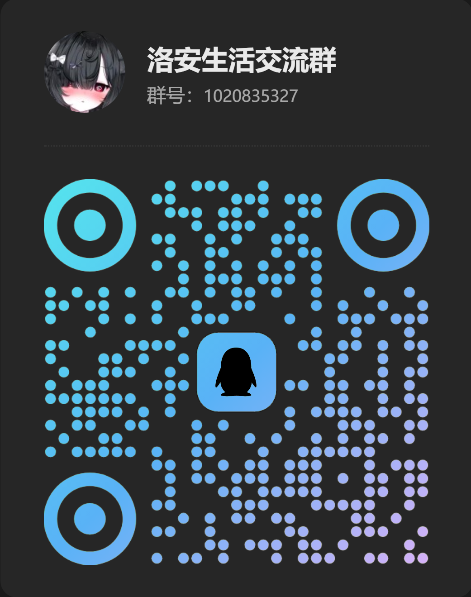

[GitHub 仓库](https://github.com/ciallo-China/GitHub-ciallo-RVC-VTFM)   ["原作者"仓库](https://github.com/Turing-Mirror/RVC-Fabric)

**社媒**　[抖音 @幼辞PS](https://www.douyin.com/user/MS4wLjABAAAA4X17Z_cLkmpc5ei8BK47O-d79pH21Av2kr07vSf3yoPw0wj81HRDqnMduM0HSdY0?from_tab_name=main)（抖音号`PUBGMobile30`）　·　[抖音 @米基哈](https://www.douyin.com/user/MS4wLjABAAAAze8B7Shs207ePe11y28jdJ8yvtRUUf39qsig7QQOoMDmVT1uSCarJJNITfj0sC3O?from_tab_name=main)（抖音号 `YOUCI_DIY2026`）　·　[快手 @幼辞PS](https://www.kuaishou.com/profile/3x6wziyhf4h9gym?source=SEARCH)（快手号 `PUBGMoblie30`）　·　QQ 群 @洛安开源社区（群号 `1020835327`）

<!-- qq-group -->

<!-- qq-group -->

## RVC VTFM

RVC VTFM 是一款面向 Windows 的本地声音转换桌面软件，基于 RVC 技术深度定制。它能把一段音频或视频里的人声换成另一个人的声线，声音数据全程只在你自己的电脑上处理，不需要联网上传，也不需要自己装 Python 或配置浏览器环境，装完打开就能用

## 核心功能

软件围绕声音转换提供了三块功能

录音转音是最常用的部分，支持 mp3、wav、m4a、flac、ogg 等常见音频格式，也能直接处理 mp4、mov、mkv 等视频文件。视频转音时画面原样保留，只把里面的声音换成目标声线

实时变音配合虚拟声卡使用，可以在通话、直播、游戏语音里实时改变自己的声音。它走的是轻量变调方案，对电脑配置要求很低，老机器也能流畅运行

广场负责下载引擎和声线。引擎分成「引擎核心」和「运行时」两类，声线则可以在官方源和第三方源里挑。广场支持多线程下载和断点续传，下到一半断了也能接着下

## 快速开始

1. 安装完成后打开软件，点「更多 → 广场」
2. 在「核心引擎」里下载「引擎核心」，在「辅助引擎」里按显卡下载对应的运行时，软件会自动放好位置
3. 在声线列表里挑一个喜欢的下载，装好后它会出现在主界面的声线网格里
4. 把要转音的音频拖进软件窗口，或者放进软件目录下的 Audio-PA 文件夹，选一个声线，点「开始转音」
5. 结果会输出到 Audio-RL 文件夹里对应的声线名下

## 实时变音

想让游戏、直播里的人听到变声，需要 VB-Cable 虚拟声卡在中间转发音频

| 项目 | 选择 |
| :--- | :--- |
| 软件输入 | 真实麦克风(或虚拟麦克风) |
| 软件输出 | CABLE Input |
| 游戏或语音软件的麦克风 | CABLE Output |
| Windows 默认播放设备 | 物理耳机（不要选 CABLE） |

VB-Cable (虚拟声卡) 下载解压后运行里面的安装程序装一次即可(所在目录"[安装目录]\RVC VTFM\Tools\vbcable"以管理员运行"VBCABLE_Setup")

## 转音参数

- 音调：半音为单位，推荐：(男转女约 +12，女转男约 -12)
- 相似度：值越高越贴近目标声线，但可能丢失一些自然感
- 保护：保留一部分原声的呼吸和气声，让结果更自然
- 音高算法：pm 最快最省内存，harvest 轻量，crepe 均衡(推荐)，rmvpe 最准
- CPU 线程：一般情况下设 "1" (默认"1") 最高可拉到 "128" (仅适用于服务器CPU)

参数自动写入配置文件，无需担心重调

## 目录说明

软件目录内文件夹所表示的意思：

- CRVC VTFM：软件本体(配置文件)，不要手动改动里面的文件
- Tools：软件自己的脚本和引擎代码备份，平时不用管
- Engine：引擎存放位置，如果误删了里面的代码，软件启动时会自动从 Tools 补回(引擎需从"RVC VTFM→广场→引擎"里下载)
- Audio-PA：输入音频，拖进去的音频也在这里
- Audio-RL：输出结果，按声线名分文件夹存放
- Voice-LP：声线包(声线需从"RVC VTFM→广场→声线"里下载)

## 推荐设备

- CPU：AMD R5 3600X
- GPU：NVIDIA GTX1060Ti 6GB
- RAM：8GB 2666MHZ C18

## 免责声明

- 模型权重、音色包及第三方资源遵循其原始许可协议
- **免责声明**：请勿将本软件用于伪造身份、欺诈或其他违法用途。使用他人声音进行训练或转换前，请取得原权利人授权。使用者应遵守当地法律法规(切勿商用)